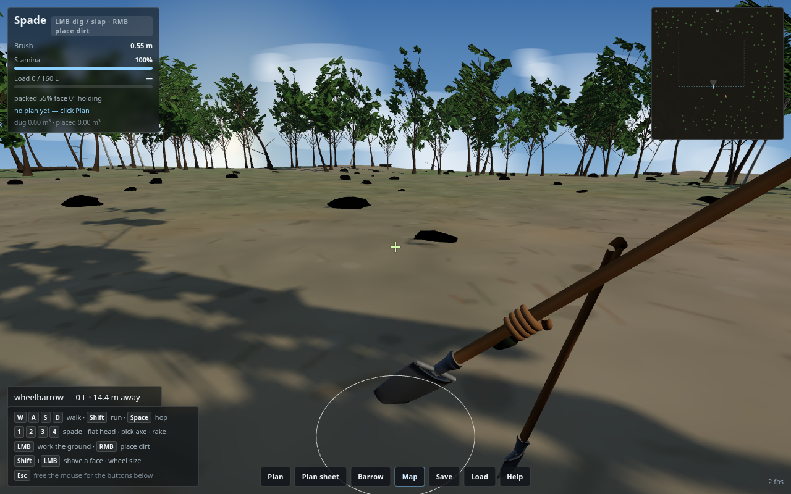
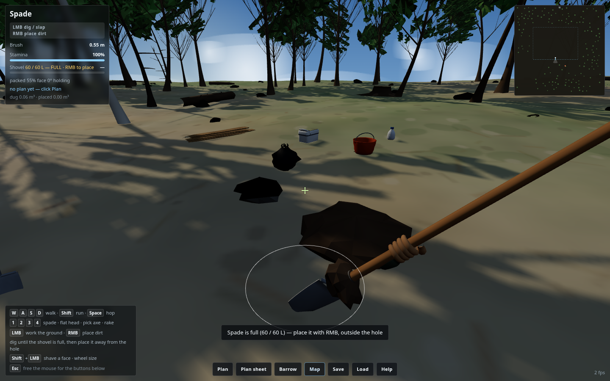

# Dirt Line

A first-person trail-building sim: walk the woods at 6 ft, plan a jump line, then
actually dig it out of the ground. Real spoil volumes, real angle of repose, and
dirt that only stays where you pack it.

**🔗 Live:** https://jacoblbagent.github.io/dirt-line/ (GitHub Pages)
**Local:** `python3 -m http.server 5187` in this directory → http://localhost:5187/
(tailnet: http://jlb-hermes.tail1caa84.ts.net:5187)


Modelled on real build photos: tall woodland with a canopy overhead, pine-needle
and leaf litter underfoot, moss, fallen logs, fractured boulders — and the gear
that piles up at the edge of a dig (buckets, cooler, jug, trash bag, stacked
planks, tools left standing in the dirt).


The riding surface is packed clay and reads noticeably lighter and smoother than
the dark loose spoil around it, because that's exactly what the soil model is
doing — packed cells are pale and firm, freshly dug or poured cells are dark and
about to slump.


## Models — every visible object is real geometry

Nothing in the game is a box, sphere, cylinder, cone or plane. Every object is
built procedurally from a geometry toolkit (`js/geo.js`): lofts through shaped
cross-sections, tapered tubes swept along curves with parallel-transport frames,
lathed profiles, and beveled extruded plates — then merged per material so a whole
object costs one draw call per material it uses.

| Object | How it's built |
|---|---|
| Spade | lathed shaft, D-grip from three swept tubes, forged socket with a rivet, arc-profile blade shell with real thickness, rolled top edge |
| Flat head | wide arc-profile blade with side bevels and a drawn edge, long orange socket with pressed step shoulders, knurled knob top |
| Pick axe | forged eye, tapered curving spike, chisel end, wedge in the eye, swelling shaft |
| Rake | bowed head bar, 12 tapered tines with forged bends, orange socket |
| Gloved hand | lofted palm that tapers from a slim wrist, four fingers swept 180° around the shaft, thumb over the top, knuckle pads, flared fabric cuff |
| Wheelbarrow | lofted tray with a rolled rim and pressed ribs, wooden handles with rubber grips, steel legs and fork braces, tire with tread lugs, dish rim, hub, six spokes, axle and hex nuts |
| Bucket | lathed vessel (outer wall, rim roll and inner wall) with ribs, bail handle with flattened ears, spoil inside |
| Cooler | lofted body with a lid seam, latches, hinges, moulded handle, drain plug |
| Water jug | lathed body with shoulder and ribs, ribbed cap, arch handle |
| Trash bag | crinkled lofted bag, cinched tie, knotted ears |
| Planks | lofted with a cup and chamfered, tapered ends, nail-hole dimples, splintered broken ends |
| Trees | 14 unique variants generated per world: trunk lofted with root flare and bark ridges, recursive tapered limbs, needle sprays (conifer) or folded leaf clusters (broadleaf), spread crowns, bare dead snags with splintered breaks |
| Rocks | lofted and displaced, sheared against two random fracture planes, faceted, with strata banding and moss on upward faces |
| Logs / stumps | curved knot-bulged trunks, sawn end grain with growth rings, splintered torn ends, branch stubs; stumps with a flared base, exposed roots and a cut top |
| Plan volumes | lofted from the intended jump profile — take-off face, tabletop, roller curve, landing slope, banked berm or bowl — so the guide shows the shape you're aiming for |

The model gallery (`tests/gallery.html`) renders every model in isolation with a
per-object vertex/NaN report, and is what the screenshots above were taken from.


## What you do

1. **Plan the line first** — the **Plan** button opens an overhead plan view. Click
   the ground to drop lips, landings, rollers, tables, berms and dirt holes. Wheel =
   radius, `Shift`+wheel = height, the ◀ ▶ buttons = take-off heading, `RMB` deletes.
2. **Dig** — `LMB` works the ground with whatever tool is in hand. Spade for firm
   ground, pick axe for hard or already-packed ground (it also loosens soil so later
   digging goes easier). Dirt leaves the ground: the hole you dig *is* the dirt you
   build with (in-situ volume, 25% bulking).
3. **Haul** — the spoil piles up **in the shovel**: you can see it sitting on the
   blade and it grows as you dig. A spade blade holds 60 L, the pick axe 70 L, and
   while the blade is full *you cannot dig another scrape* — `LMB` just tells you to
   empty it. Stand next to the wheelbarrow instead and you shovel straight into it
   (400 L, no stopping).
4. **Place** — `RMB` tips what you carry where you are looking, and the mound is the
   same amount of dirt you dug: the heap's footprint comes from its volume, so 60 L
   lands as a real pile rather than a smear. **You cannot tip it back into the hole
   you are digging** — the HUD says so and the placement ring turns red; walk clear
   first. The wheel sets the spread, `Shift`+`RMB` trickles it out.
5. **Pack** — poured dirt is *loose*: it slumps under gravity to its angle of
   repose (~38°) and keeps falling until it stops. `LMB` with the flat head packs it
   (preferred, smooth sheen); the back of the spade slaps it down too, leaving ridge
   marks. Packed faces hold 60°+. Firm ground is pale and dry-looking; loose spoil is
   dark and muddy.
6. **Shave** — `Shift`+`LMB` takes a clean flat cut off a lip or a landing face: a
   thin, even plane of dirt for precise adjustment.
7. **Rake** — `LMB` levels and grooms, dragging high spots into hollows.

## Controls

Three rules and a small keyboard — everything else is a button.

| Input | Action |
|---|---|
| `W A S D` | walk (`Shift` run, `Ctrl` crouch, `Space` hop) |
| mouse | look (click once to lock the pointer, `Esc` to free it) |
| `1 2 3 4` | spade / flat head / pick axe / rake |
| `LMB` | work the ground with the tool in hand (stops while the blade is full) |
| `RMB` | place the spoil you carry, outside the hole (trickle with `Shift`) |
| `Shift`+`LMB` | shave a flat face |
| wheel | radius — brush size and dump radius together |
| **buttons** | Plan · Plan sheet · Barrow · Map · Save · Load · Help |

That is the whole keyboard. Plan mode, the plan sheet, the wheelbarrow, the map,
saving and help all live on the button bar at the bottom of the screen; press `Esc`
to release the pointer, click what you want, then click the world to start digging
again. The plan sheet is click-through, so you can leave it open as a reference
while you work the dirt.



## The shovel is the rule

Spoil lands on the blade as you dig, and the blade is what limits you: a full
shovel cannot take another scrape until you have emptied it. Place it and the
mound is the dirt you took out — the heap's radius is derived from its volume
(`r = ∛(3V/π·tan)`, a cone at the angle of repose), so a spade-load stands as a
pile rather than spreading into an invisible film. Aim inside the hole you dug and
placement is refused (HUD warning, red ring): this is a building sim, not a
shuffling-the-same-dirt sim. Shovelling into a barrow standing beside you is the
one exception to the full-shovel stop.



## The dirt model

Each of the 65,536 (`257²`) heightfield cells at 0.5 m keeps:

- **height** — the shape,
- **packed** (0–255) — how firm the ground is. Sets the angle it can hold
  (`tan = 0.70 + packed/255 · 3.30`, i.e. ~38° loose → ~66° packed),
- **hardness** — natural resistance; the pick axe eats it, the spade struggles in it,
- **settle** — metres already compacted out, so slapping a face a hundred times
  firms it without slowly flattening the jump you just built,
- **mark** — which tool last worked the cell, painted onto the ground texture
  (flat-head sheen, spade ridges, rake grooves, pick-axe pocks).

A cellular-automaton slump runs every frame on a dirty-cell queue: any cell steeper
than its own repose passes material downhill, volume-conserving to ~1e-4 m³. That
one rule gives you cone-shaped spoil heaps, dirt that runs off an unfinished lip,
and faces that stay exactly where you packed them.

## Running it

```bash
cd ~/Code/dirt-jumps
python3 -m http.server 5187        # ES modules need HTTP, not file://
```

No build step, no CDN: `three.module.js` (r160) is vendored locally. Save/load is
localStorage (`K` / `L`). `New world` on the title screen reseeds the procedural
terrain — rolling forest floor, a clear dirt zone for lines, scattered trees that
keep out of the way of the zone.

## Layout

```
index.html          HUD + overlays, error catcher, three.js module shim
style.css           HUD/overlay chrome
js/config.js        world + soil constants
js/noise.js         value noise / FBM
js/terrain.js       heightfield, soil state, brushes, slumping, surface texture
js/tools.js         tool definitions + first-person tool models and swing
js/player.js        first-person controller, aim ray-march, work loop, barrow
js/plan.js          plan features, ghost guides, progress, minimap
js/geo.js           geometry toolkit: lofts, tubes, lathes, beveled plates, merge
js/materials.js     shared vertex-coloured material set
js/models-tools.js  spade, flat head, pick axe, rake, gloved hand
js/models-props.js  wheelbarrow, bucket, cooler, jug, bag, planks, dirt heaps,
                    plan-feature profiles
js/models-plants.js trees (pine/broadleaf/birch/snag), rocks, logs, stumps
js/props.js         staging gear + fallen logs (scene dressing)
js/ui.js            HUD, plan sheet, plan-mode chrome
js/sfx.js           WebAudio foley (scrapes, tamps, pours, wind bed)
js/main.js          bootstrap, world build, input, main loop
```

## Verified

51/51 headless checks (Playwright + swiftshader Chromium) covering digging,
volume conservation, angle of repose, packing vs loose, shave, rake, tool
hardness bias, precision dump radius, plan round-trip and progress, player
locomotion at 1.83 m eye height, tree collision, barrow logistics, plan camera,
save/load, and the live render loop.

Budget: ~1.05 M triangles and 42 draw calls per frame for the whole world
(147 trees, 170 rocks, 34 logs/stumps, terrain, props, held tool), with 48
geometries resident. Run `tests/verify.js` against the served build; the headless
frame rate in those runs is software rasterisation and says nothing about real
hardware.
